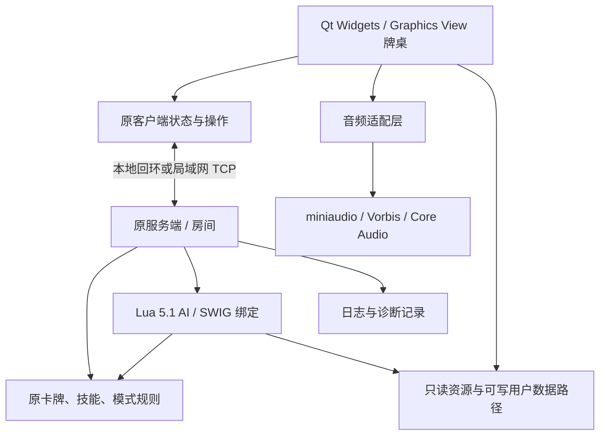

# 太阳神三国杀「涅槃版」macOS 原生移植 — Design Spec

版本：0.1 · 日期：2026-09-26 · 状态：设计已编写，待审阅；尚未实施或完成编译验证。

依据：[可行性调研](FEASIBILITY.md)。用户已批准源码移植方向，本轮确认的产品范围见 [决策记录](DESIGN_DECISIONS.md)。本文中的目录、接口、命令和测试结果要求均为实施设计，不代表已经存在或通过验证。

## 1. 目标与首版边界

交付一个 Apple Silicon 原生 macOS 应用，复现用户本地 `/Applications/QSanguosha.app` 的 20120715「涅槃版」内容与交互，让用户先实际试玩验收，再根据具体 bug 持续维护。

| 范围 | 首版约定 |
|---|---|
| 平台 | arm64；以用户当前 macOS 26.6.2 为必须通过的验收环境 |
| 系统最低版本 | 首版部署目标设为 macOS 26.0；26 的其他小版本仅在实际验证后声明支持 |
| 内容 | 本地原装武将、卡牌、模式、场景、中文、AI、图片、字体和音效 |
| 对战 | 单机 AI；同一新版本之间局域网／可达 IP 直接连接 |
| 数据 | 新配置；保留首版自身的配置保存和新录像录制／回放功能 |
| 交付 | 可独立运行的 `.app` 和 ZIP、本地源码、构建说明、验证报告、已知差异清单 |
| 首版不验收 | Intel、macOS 13–15、旧客户端互通、个人旧录像／配置导入、额外 DIY 扩展 |
| 未来事项 | 公开分发、公证、App Store、自动更新、云服务、新武将和规则更新 |

“不验收旧数据／额外 DIY”不意味着删除原装录像功能、原装扩展包或游戏内已有工具。实际原装菜单及其功能由 M0 清单冻结；候选源码中本就未实现的菜单动作按历史状态登记，不将其扩展为新功能。

直接 IP 连接只承诺路由可达的主机，不承诺 NAT 穿透、自动端口映射或外网大厅服务恢复。单机启动时只监听回环地址；用户明确创建联机房间时才监听局域网接口。

## 2. 1:1 的可验证定义

保真优先级依次是规则与状态变化、交互与反馈、原始内容、布局及动画时序。画面保留旧版美术风格，不重新设计主界面。

必须保持：

- 武将／卡牌标识、包顺序、技能触发条件、结算顺序、胜负条件及模式选项。
- 原默认选项和禁用包策略，以新配置启动；不将本机个人偏好误当成原版默认值。
- 选牌、选目标、取消、确认、拖动／双击及快捷键在该版本实际支持范围内的语义。
- 牌桌布局、原文字和素材、音效触发、重复音效抑制、BGM 循环及音量控制。
- 原 AI 策略。保留随机决策行为，不要求同一操作在不同运行中必然得到同一 AI 选择。

允许并记录：系统标题栏、字体抗锯齿、高分屏采样差异；避免崩溃所需的内存／线程修复；替换框架产生但不改变玩法的实现差异。中文缺字、遮挡、错位、目标点击偏移和播放遗漏不属于可豁免的像素差异。

旧玩法 bug 登记在案后等用户指示修复。兼容迁移导致的新 bug 必须修复。旧版阻断启动／完整对局的 bug 可先修复，但要写明复现、原行为、新行为及受影响规则，不借此更改平衡。

## 3. 已知证据与源码冻结

本地主程序为 x86_64，动态依赖 Qt 4.8.0、FMOD、libstdc++ 和 libgcc。配置标识为 `20120715 / 涅槃版 / official`，主程序 SHA-256 为 `94e648da8f805438ff6c42ad761504bf89d80e2a8c6c0c3e9e294e00732cea82`。

原仓库为 [Mogara/QSanguosha](https://github.com/Mogara/QSanguosha)。已抽查提交 `fe5baeb52f613696e49e9117225af17b25165831`，它是候选样本而非已批准的实施基线：其配置仍标为踏青版，多个文件及包配置与本地不同。本文具体接口观察均需在最终基线上复核。

M0 必须完成以下源码冻结流程：

1. 只读取得原应用文件清单、SHA-256、架构与资源目录；保存独立快照，不改动原应用和配置。
2. 获取原仓库历史并检索发布日前后、历史分支及必要 fork；用资源 Git blob、Lua API、包／技能符号和构建线索匹配，不仅按日期猜测。
3. 枚举本地 `config.lua` 中的 26 个包项、6 个命名场景和追加的 33 个 MiniScene 项。配置声明、注册成功、界面可选和实际可玩分别记录，不用配置数冒充有效功能数。
4. 为所有原装菜单、模式和工具建立功能清单；为每个包生成角色、技能、卡牌及 AI 注册表，并记录缺项和默认禁用状态。
5. 输出 `baseline.json`：源仓库／SHA、原应用哈希、资源清单哈希、补丁列表、内容表、已知差异及证据等级。

证据等级：A = 可运行旧版对照；B = 匹配的历史源码及本地资源相互印证；C = 候选源码或推断。逐项标注，不将 C 项写成已验证一致。

若无法恢复精确源码但可用有限、可解释的历史补丁对齐，则提交差异清单供用户决定。不得静默换成 V2、减少模式或套用新技能。M0 未通过时可完成独立的框架／音频技术探针，但不能冻结玩法基线或宣称完整复刻。

旧版对照优先采用确实可运行的同版本环境；若只能取得同版本 Windows 构建，它可辅助核对玩法，不能证明旧 Mac 的像素、字体和平台交互一致。本轮未启动旧程序，也未验证任何旧环境可运行。

## 4. 总体结构

保留现有 C++ 游戏引擎、客户端、服务端、Lua AI 和 Graphics View 牌桌。平台适配集中在音频、路径、构建、日志和 Qt API 边界，先建立明确责任，再逐步改善旧代码；首版不强行拆散所有历史类。



单机沿用原本的“内置服务端 + 本地客户端”路径，使规则、AI 和联机共用结算实现。首版不增加另一个独立单机规则引擎。牌桌对象限主线程访问；每个房间的状态变更及 Lua 执行遵循单一所有者，禁止并发进入同一 Lua state。

候选代码的 Room 继承 QThread，且使用信号和信号量。实施时必须逐个检查 QObject 线程归属与真实调用线程，不能认为继承 QThread 就代表所有方法都在工作线程执行，也不能机械地把所有连接改成 QueuedConnection。

## 5. 技术选型

| 部分 | 选型 | 约束与理由 |
|---|---|---|
| C++ | C++17、Apple Clang、libc++ | 与现代 Qt 对齐，优先保留历史语义 |
| UI / 网络 | Qt 6.11 系列；Core、Gui、Widgets、Network、Sql | 官方支持 macOS 26 / arm64，沿用 Widgets 和 Graphics View |
| Qt 兼容 | Core5Compat 仅用于确有需要的旧正则／编码接口 | 避免一次更换正则语义造成玩法解析变化；每个用途登记 |
| 构建 | CMake + Ninja，Qt AUTOMOC / AUTOUIC / AUTORCC | 替代 qmake 作为新版本唯一正式构建入口 |
| Lua | 冻结基线中的 Lua 5.1 源码，重编为 arm64 | 本地字符串为 5.1.4；不升级到 5.4 或引入 LuaJIT |
| 绑定 | SWIG 4.x 的固定验证版本 | 保持 `sgs` API 和对象所有权；生成代码可重复生成 |
| 音频 | miniaudio 高层 engine + libvorbisfile / libvorbis / libogg，Core Audio 输出 | 重用 OGG 素材和高层混音，移除旧 FMOD 二进制依赖 |
| 字体 | 原 TTF；保留游戏实际使用的 FreeType 渲染路径并重建其依赖 | 不随意改用系统字体导致字体度量变化 |
| JSON 等 | 游戏协议先保留原库语义；兼容补丁逐项审查 | 不顺带切换序列化格式 |
| 崩溃诊断 | 符号文件 dSYM、Qt 日志及系统崩溃报告 | 首版不接入外部遥测平台 |

Qt 6.11、miniaudio、SWIG 等的精确补丁版本／提交、来源 URL、SHA-256、许可和补丁在 M1 技术探针通过后写入 `dependencies.lock.json`。正式构建必须使用该锁文件，禁止浮动 master 或隐式采用系统最新版本；当前尚未完成该验证，不能把系列选型当成可复现依赖锁。

依赖一律从源码或可验证的 arm64 包取得。Qt 动态框架随应用打包；Lua、音频解码等尽量作为应用私有构建依赖。构建机器的 Homebrew 可帮助准备工具，但产物不得依赖 `/opt/homebrew` 或开发机的 Qt 安装路径。

## 6. 关键迁移设计

### 6.1 Qt 与界面

- 迁移 QtGui 中已拆出的 Widgets 头文件，处理废弃 API、容器索引宽度、元类型和信号签名；仅修复实际使用路径。
- 牌桌保持原逻辑坐标和缩放比例；Qt 高分屏设备像素比只处理一次，避免手动缩放和框架缩放重复应用。
- `itemAt` 等接口使用正确的视图变换；回归点击、拖牌、悬停和多层手牌命中。
- 固定旧版游戏配色和字体配置，避免系统深色模式替换牌桌颜色；系统窗口装饰不作为逐像素目标。
- 将计时跨度改用单调时钟，如 QElapsedTimer；保留出牌超时、动画延迟、响应优先级的历史值。
- 本地和候选快照各只发现一个 QML 文件：致谢页，内容是两张图片及返回点击。默认用 QGraphicsPixmapItem 和点击项按原位置实现，去掉此处 Qt Quick 1 依赖，避免为一个静态页面引入新渲染体系。若 M0 发现更多实际 QML 行为，再重新评估，不删减动画。

### 6.2 规则、Lua 与随机行为

规则源码和 Lua AI 的玩法变更独立于平台补丁提交。卡牌 ID 与包加载次序由内容清单冻结；不为“整洁”重新排序注册表。

Lua 继续执行原 5.1 语义，重点验证 QVariant 转换、Qt 容器包装、返回对象所有权、Lua GC 与 QObject 析构、错误回传及长时间对局。SWIG 更新可能改变包装语义，必须通过这些边界测试才接入完整 AI。

本地启动脚本包含相对路径及 `.dll` 搜索项，目录还附带两个 Windows DLL。必须绘制实际 `require` / `dofile` 依赖链：运行路径需要的原生模块必须从源码重建为 arm64 并调整私有模块路径；仅属附带开发工具且不被游戏使用的文件登记为历史附属物。禁止直接装载旧 DLL，也不能因文件存在就假定核心玩法依赖它。

原逻辑和 Lua 各自使用随机数，AI 内还有 `os.time()` 播种。迁移封装 RandomSource，区分规则、AI 和纯展示随机；正式玩法保持规则概率与策略。测试模式可注入牌序、种子和玩家决策，并记录各随机源与逻辑请求次序。相同种子不保证旧系统与新系统完全同一序列；做跨版差分时应使用固定牌堆和记录的选择／随机结果，禁止声称仅保存种子即可完整复现。

### 6.3 音频

保持现有 `Audio::init / quit / play / stop / playBGM / setBGMVolume / stopBGM` 调用边界，内部替换实现；`getVersion` 如实返回新后端版本。

已观察到本地 477 个音频文件全部为 `.ogg`，候选旧实现限制约 100 个播放通道，并在同一音效仍播放时忽略重复调用。迁移契约如下：

| 行为 | 要求 |
|---|---|
| 技能／卡牌音效 | 按原逻辑选择文件；同文件播放中不重复启动，不同文件可叠加 |
| 缓存 | 已播放资源可缓存，播放期间持有资源；淘汰缓存不能释放仍在播放的对象 |
| BGM | 单一循环通道、独立音量；换曲前停止并释放旧资源 |
| 停止／退出 | 先停止播放，再释放 voice、解码器、资源和 engine，避免回调访问失效内存 |
| 通道上限 | 初值按候选历史 100 通道；满载时行为须在最终基线上复核，并记录降级 |
| 故障 | 缺文件或无音频设备可继续对局，日志给出文件／设备原因；验收不能以永久静音通过 |

Vorbis 解码接入 miniaudio 的自定义 decoder / resource manager，不依赖系统碰巧支持 OGG。原文件不转码、不重采样后覆盖；输出设备所需采样率转换发生在播放阶段。后台线程完成解码，音频回调中不访问 Qt UI、不执行 Lua、不做文件读写。验证设备切换、静音、睡眠唤醒后恢复。

### 6.4 联机协议

保留原 TCP 消息及服务端裁定规则，Qt Network 负责网络。修复废弃 socket 错误信号、消息分帧及字节转换；中文文本不得用现代 API 的便捷替换悄悄截断。保留旧编码／转义语义的地方需要黄金样本验证；新版本若明确切换 UTF-8，应统一两端并标识协议版本。

新增连接前兼容检查：`productProtocol = qs-modern/1`、规则基线 ID、卡牌／武将注册表哈希和规则脚本内容哈希；不要求纯图片文件哈希一致。双方匹配后才接受选将／开局，不匹配时提示使用同一版本。旧客户端不得被当作已验证的新协议端。

原候选协议按换行分帧，新实现使用增量缓冲，覆盖半包、粘包、断开及无结束符输入；单消息初始上限 1 MiB，经基线最大合法消息验证后锁定。不要保留旧固定小缓冲区造成的截断。

保留房间创建、加入、AI 补位、局域网发现（原功能确认后）和直接 IP。首版不新增断线重连语义；原本存在的重连行为按 M0 清单保留。至少两台设备间完成对局才可标记 LAN 验收通过，单机两个进程只能验证协议，不能代替真实局域网测试。

### 6.5 资源路径与用户数据

拟用显示名 `太阳神三国杀·涅槃重制`，包标识 `org.qsanguosha.nirvana.modern`（本地用途命名，不声称属于原维护团队）。产品版本如 `0.1.0-preview.1` 与历史内容版本 `20120715` 分开显示。

```text
QSanguosha-Nirvana.app/Contents/
  MacOS/QSanguosha
  Frameworks/                 # Qt 与实际需要的私有动态库
  PlugIns/                    # Cocoa、图片格式、SQL 等所需插件
  Resources/game/             # 原目录结构、图片、OGG、字体、Lua、翻译
  Resources/licenses/
  Resources/build-info.json
```

PathService 提供 `resourceRoot`、`configRoot`、`dataRoot`、`cacheRoot`、`logRoot`。用户数据使用新命名空间，通过 QStandardPaths 确定位置；配置、录像、日志和导出文件全部写到应用包之外。自定义场景编辑及制卡工具如在基线中可用，其输出也必须通过显式可写路径保存。

为降低改动面，可在启动早期将进程工作目录固定到只读 `Resources/game`，兼容旧资源引用；这不是允许在资源目录写文件。所有写调用须审计并转向用户路径，Lua 脚本路径建立绝对搜索根，最终产物从 Finder、终端或含中文／空格的目录启动都必须成功。

采用新配置命名空间，明确组织／应用标识并在 Settings 初始化前设置，不读取旧 `QSanguosha.com` 偏好。同机多实例测试使用各自的数据目录，避免配置和日志相互覆盖。缓存损坏可重建，配置写入使用临时文件和原子替换。

### 6.6 录像与诊断

首版必须能录制并回放自身生成的对局。保留已有可用的文字／图片录像入口；旧录像不在兼容承诺中。

候选 PNG 录像代码涉及原始内存长度、ARGB32 行跨度和主机字节序，必须单独审计；不能照搬未验证的缓冲区算法。新录制文件带有格式版本及规则基线元数据，文字／PNG 封装均需往返校验和截断输入验证。对缺少新元数据的旧文件提示“未验证旧版格式”，不把它误认成新版本录像；不为此修改原文件。

常规日志记录构建 ID、内容基线、平台、资源加载、Lua 错误、房间生命周期和崩溃前事件，不记录联机中不可见的全量手牌。用户可主动导出诊断包，包含日志、可选录像、配置摘要和复现说明；没有自动上传。完整牌堆／随机序列仅在明确的本地测试或用户选择的诊断模式记录。

后续 bug 工单最小字段：构建版本、模式、武将与相关技能、复现步骤、预期／实际结果、是否稳定复现、日志／录像。修复流程是复现 → 最小规则或交互用例 → 单独修复 → 验证受影响场景 → 新预览版本，持续保留未修旧 bug 清单。

## 7. 工程与构建交付

尽量保留历史目录，便于回查上游代码；新增边界和工具独立放置。拟定布局：

```text
src/{core,client,server,package,scenario,ui,dialog,util}/
src/platform/{audio,paths,diagnostics}/
lua/  swig/  assets/  third_party/
cmake/  tools/  tests/{rules,bindings,protocol,assets,replays}/
docs/{baseline,validation,known-issues}/
CMakeLists.txt  CMakePresets.json  dependencies.lock.json
```

M0 导入后先保存不含移植改动的基线提交，再按构建、Qt API、音频、路径、规则修复分开提交。源码注释、许可证和原作者署名保留；本地素材快照与代码来源分开登记，禁止未经用户要求公开推送素材或发布安装包。

计划提供 `macos-arm64-debug`、`macos-arm64-release`、`macos-arm64-asan` 三个构建预设。CMake 完成 SWIG、moc、uic、翻译生成、依赖构建和资源安装；不得要求开发者手动复制构建中间文件。

打包流程：Release 构建 → CMake install 到 staging → Qt macdeployqt → 复制所需插件及许可 → 检查所有 Mach-O 为 arm64 → 检查动态库加载路径 → 最终签名 → 产物验收 → ZIP 与校验和。先完成嵌套库签名再签应用，签名后不修改资源；保存匹配的 dSYM。

首版本机构建采用本地 ad-hoc 签名验证，不据此声称已通过 Apple 公证或可在其他机器免提示安装。不改变用户全局 Gatekeeper 设置；若后续需要互联网下载分发的免提示体验，再单独决定 Developer ID／公证流程。

交付验证必须移动产物到独立路径并清理 Qt／Homebrew 相关环境变量，确认依赖均位于应用包或系统路径。在无开发依赖的测试用户／设备执行安装和启动验证；仅在构建目录中运行不算交付验收。

## 8. 测试与首版验收

详细场景、预期来源、执行状态和证据要求见 [Test Spec](TEST_SPEC.md)。下表保留为验收需求入口。

所有下列数字为拟定的最低验证门槛，不是现有测试结果，也不等于穷举所有技能组合。

| 编号 | 验收要求 | 证据 |
|---|---|---|
| A01 | macOS 26.6.2 / arm64 从 Finder 启动；不需要 Rosetta 或外部 Qt | 架构、依赖报告；干净环境启动记录 |
| A02 | M0 清单内所有包／角色／技能／卡牌／场景均可注册，无未解释缺项 | 逐项内容差异报告及资源扫描 |
| A03 | 主界面、设置、选将、牌桌、结算、原装工具可进入；手牌／目标操作无偏移 | 固定状态截图及操作检查表 |
| A04 | 标准身份模式至少 20 局 AI 完整结束，至少 3 局用户操作完整对局 | 种子／输入、结果和错误统计 |
| A05 | 每个独立模式族至少一局完整流程；每个声明可用场景有可加载及关键规则检查 | 按模式／场景清单逐项报告，不把初始化算通关 |
| A06 | 杀闪、伤害、濒死救援、死亡、连环、判定、无懈响应、装备／距离、触发顺序和胜负结算 | 固定牌序规则用例；证据 A/B/C 标注 |
| A07 | 477 个 OGG 全部可解码；抽听 BGM、技能、卡牌及重复／叠加；音量和设备恢复可用 | 解码清单、听感记录、设备切换检查 |
| A08 | 两台设备同版 LAN／IP 完成至少 3 局；错误版本拒绝开局；断开不致 UI 死锁 | 双端日志和兼容检查结果 |
| A09 | 新录像录制／回放及文字／图片转换往返成功，状态／顺序正确 | 有版本元数据的样本和自动验证 |
| A10 | 配置重启保留；新旧应用配置互不覆盖；应用包内无运行写入 | 文件前后差异和路径测试 |
| A11 | 2 小时连续运行、10 次建房退出，无崩溃／死锁；无未处理 ASan 内存错误 | 压测、资源趋势、ASan 报告 |
| A12 | 依赖锁、干净构建、打包脚本和文档能重建同内容版本 | 新构建目录重建记录；不要求签名产物字节完全相同 |

视觉检查固定相同逻辑窗口尺寸和游戏状态，至少覆盖 1× / 2× 渲染；字体边缘允许差异，位置、可读性和点击目标不允许退化。AI／服务器运算期间 UI 必须响应，不把等待玩家和正常出牌超时误报为死锁。

自动测试只投入关键语义：规则时序、脚本绑定、协议分帧、音频状态管理、录像内存边界、资源完整性。像素外观和音效感受用人工检查，避免大量只复述实现的测试。日常按变更范围运行；发布前执行完整验收矩阵。

没有第二台设备、旧版对照或特定场景证据时，对应项保持“未验证”，不得以本机替代测试冒充通过。首版可以先交付明确标注缺项的阶段预览，但只有所有必须项通过或用户逐项接受例外，才能称为验收完成。

## 9. 里程碑与退出标准

| 阶段 | 工作 | 必须产出／退出条件 |
|---|---|---|
| M0 基线冻结 | 快照、历史源码匹配、功能清单和差异证据 | baseline.json、内容表和差异记录；精确匹配或用户接受具体替代基线 |
| M1 关键技术验证 | arm64 Qt 界面、Lua 绑定、OGG 音频、依赖构建与打包探针 | 探针实机可运行，依赖精确锁定；不代表完整游戏可玩 |
| M2 标准对局贯通 | 核心规则、AI、牌桌、路径和中文 | 单机标准对局完整结束，无阻断崩溃；可供提前预览 |
| M3 内容与功能完整 | 全部原装包／模式／场景、工具、音频、同版联机、新录像 | 功能清单逐项完成；所有缺项明确可见 |
| M4 首版交付验收 | 打包、回归、两机联机、耐久测试、用户试玩 | A01–A12 报告、APP／ZIP／源码／已知差异；用户确认体验 |
| M5 按反馈维护 | 用户逐条提供 bug，建立复现和回归 | 每次修复可追溯、可重建，并发布独立版本 |

M0 与 M1 是降低不确定性的技术门槛。此前 6–12 人周仍是范围粗估；在这两个阶段完成后，按真实源码差异和编译结果重新估算，不将本设计当成固定时间承诺。

## 10. 风险与变更规则

| 风险 | 处理方式 | 何时需要用户拍板 |
|---|---|---|
| 找不到精确发布源码 | 深入历史／fork 匹配，输出具体内容和行为差异 | 需要改换版本、重建无法证明的规则或接受保真缺口时 |
| Qt 升级改变界面／事件语义 | 边界适配及固定状态对照 | 必须改变可见交互或删减功能时 |
| 旧规则存在崩溃或死锁 | 最小复现、必要修复并记录 | 修复必须改变玩法且有多个合理选择时 |
| 新音频后端不满足要求 | 在 M1 用原素材验证，保留 Audio 边界可替换实现 | 只有替代方案涉及费用或明显音效差异时 |
| 缺少旧版／第二设备测试 | 保留未验证状态，提供可执行验收步骤 | 若要求把缺验证项豁免为最终通过时 |
| 原装素材权利不清 | 记录来源，保持本地验证范围 | 用户希望公开分发或商用时 |

常规工程选择由实施方负责：具体依赖补丁版本、CMake 组织、API 替换、日志格式和不影响用户体验的内部修复不反复询问。影响版本基线、功能范围、可见体验、兼容承诺或费用的变更，提供具体差异后单独询问用户。

当前没有待拍板的产品范围项。源码精确匹配、依赖锁定及实际可运行性是后续实施验证项，不能把用户同意设计当成它们已经验证。

## 11. 参考资料

- [原仓库历史构建文件](https://github.com/Mogara/QSanguosha/blob/fe5baeb52f613696e49e9117225af17b25165831/QSanguosha.pro)：历史目录、依赖及源文件组织。
- [候选历史音频封装](https://github.com/Mogara/QSanguosha/blob/fe5baeb52f613696e49e9117225af17b25165831/src/core/audio.cpp)：播放、重复音效抑制和音量行为。
- [候选历史网络实现](https://github.com/Mogara/QSanguosha/blob/fe5baeb52f613696e49e9117225af17b25165831/src/util/nativesocket.cpp)：TCP 分帧及局域网发现。
- [候选历史录像实现](https://github.com/Mogara/QSanguosha/blob/fe5baeb52f613696e49e9117225af17b25165831/src/util/recorder.cpp)：文字／PNG 录像与回放。
- [Qt macOS 支持](https://doc.qt.io/qt-6/macos.html)、[迁移指南](https://doc.qt.io/qt-6/portingguide.html)、[部署文档](https://doc.qt.io/qt-6/macos-deployment.html)、[标准路径](https://doc.qt.io/qt-6/qstandardpaths.html)。
- [miniaudio 官方手册](https://miniaud.io/docs/manual/index.html)：Core Audio 后端、资源管理及自定义 Vorbis 解码接入；具体 API 以锁定版本为准。
- [Lua 5.1 官方手册](https://www.lua.org/manual/5.1/)：脚本和 C API 语义基准。
